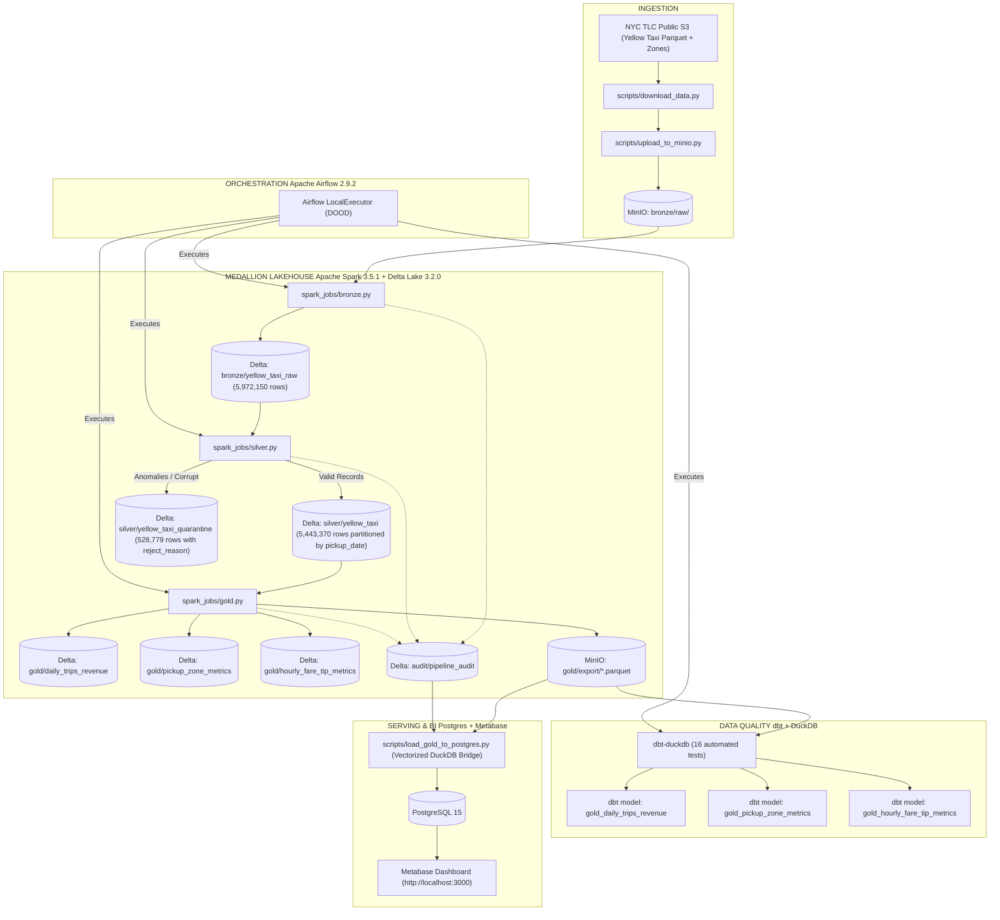
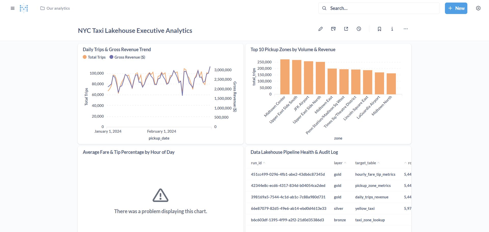

<div align="center">

# NYC Taxi Lakehouse
### Production-Grade Local Data Engineering Platform

[](https://www.python.org/)
[](https://spark.apache.org/)
[](https://delta.io/)
[](https://airflow.apache.org/)
[](https://www.getdbt.com/)
[](https://duckdb.org/)
[](https://min.io/)
[](https://www.metabase.com/)
[](https://www.docker.com/)

**A 100% free, fully local, end-to-end Medallion Lakehouse Platform built on the NYC TLC Yellow Taxi dataset (~5.97 million records).**

</div>

---

## Overview

This project is a **senior-level Data Engineering portfolio platform** demonstrating production Lakehouse patterns on commodity hardware with no cloud account required. It processes 60 days of NYC Yellow Taxi trip data through a fully orchestrated, idempotent, fault-tolerant medallion pipeline with BI-ready analytics.

### Key Engineering Highlights

| Capability | Implementation |
|---|---|
| **Medallion Architecture** | Bronze to Silver to Gold on MinIO (S3-compatible) using Delta Lake ACID transactions |
| **Data Quality & Quarantine** | 528K invalid records automatically quarantined with typed `reject_reason` codes |
| **Idempotent Pipelines** | Dynamic partition overwrites + natural-key deduplication — zero duplicates on any re-run |
| **Enterprise Orchestration** | Airflow DAGs triggering Docker containers (DoD architecture) with retry policies |
| **Analytical Serving** | DuckDB vectorized bridge to PostgreSQL to interactive Metabase executive dashboard |
| **Performance Engineering** | Empirical Spark benchmark suite with columnar storage, partition pruning, and caching |
| **Automated Quality Gates** | 11 PySpark unit tests + 16 dbt schema/business-logic tests against DuckDB |

---

## System Architecture



---

## Metabase Executive Dashboard

The platform automatically provisions a 4-tile interactive analytics dashboard backed by live PostgreSQL Gold tables.



| Tile | Chart Type | What It Shows |
|---|---|---|
| **Daily Trips & Gross Revenue Trend** | Dual-axis combo line chart | Daily volume fluctuations and seasonal revenue patterns (Jan-Feb 2024) |
| **Top 10 Pickup Zones by Volume & Revenue** | Horizontal bar chart | Top commercial hubs: Midtown Center, JFK Airport, Upper East Side |
| **Average Fare & Tip Percentage by Hour** | Line chart | 24-hour fare surge cycles and passenger tip rate behavior |
| **Pipeline Health & Audit Log** | Data table | Live run IDs, layer, rows processed, quarantine counts, and run timestamps |

> **Access**: http://localhost:3000/dashboard/1  
> **Credentials**: `admin@lakehouse.local` / `Admin123456!`

---

## Quickstart

### Prerequisites

- [Docker Desktop](https://www.docker.com/products/docker-desktop/) v24+
- `make` (macOS/Linux) or PowerShell (Windows)
- 8 GB RAM / 4 CPU cores recommended

### One-Command Launch

```bash
# Linux / macOS
make bi

# Windows PowerShell
.\make.ps1 bi
```

This single command will:
1. Start MinIO, PostgreSQL, Spark, dbt, and Metabase containers
2. Sync the Gold analytical tables into PostgreSQL
3. Auto-provision the Metabase dashboard at **http://localhost:3000/dashboard/1**

### Full Command Reference

| Action | Linux / macOS | Windows | Description |
|---|---|---|---|
| **Start Core** | `make up` | `.\make.ps1 up` | Start MinIO, Spark, and dbt |
| **Run Pipeline** | `make run-pipeline` | `.\make.ps1 run-pipeline` | Ingest then Bronze then Silver then Gold |
| **Unit Tests** | `make test` | `.\make.ps1 test` | 11 PySpark pytest unit tests |
| **Orchestration** | `make up-orchestration` | `.\make.ps1 up-orchestration` | Start Airflow and all services |
| **Trigger DAG** | `make trigger-dag` | `.\make.ps1 trigger-dag` | Trigger end-to-end Airflow DAG |
| **dbt Tests** | `make dbt-test` | `.\make.ps1 dbt-test` | 16 dbt data quality tests |
| **Benchmarks** | `make benchmark` | `.\make.ps1 benchmark` | Spark performance benchmark suite |
| **Launch BI** | `make bi` | `.\make.ps1 bi` | Start Metabase and provision dashboard |
| **Stop All** | `make down` | `.\make.ps1 down` | Gracefully stop all containers |
| **Clean** | `make clean` | `.\make.ps1 clean` | Tear down containers and wipe volumes |

---

## Pipeline Walkthrough

### Stage 1 - Ingestion

**Scripts**: [download_data.py](scripts/download_data.py), [upload_to_minio.py](scripts/upload_to_minio.py)

- Streams **~100 MB** of NYC TLC Yellow Taxi Parquet files for **January and February 2024** plus `taxi_zone_lookup.csv` from the official CloudFront CDN.
- Uploads to `s3a://bronze/raw/` in MinIO using idempotent pre-flight hash/size checks — safe to re-run anytime.

---

### Stage 2 - Bronze Layer

**Script**: [spark_jobs/bronze.py](spark_jobs/bronze.py)

- Ingests raw Parquet and CSV into unified **Delta Lake** tables with zero transformation.
- Appends two lineage columns to every row:
  - `_ingestion_ts` — UTC timestamp of ingest event
  - `_source_file` — originating S3 URI for full audit traceability
- **Output**: `5,972,150` raw trip records + `265` taxi zones written to Delta.

---

### Stage 3 - Silver Layer

**Script**: [spark_jobs/silver.py](spark_jobs/silver.py)

Applies 6-tier validation with hierarchical reject tagging:

| Rule | `reject_reason` Tag |
|---|---|
| Null business key column | `NULL_KEY_COLUMN` |
| Fare amount <= 0 | `INVALID_FARE_AMOUNT` |
| Trip distance <= 0 or > 500 miles | `INVALID_TRIP_DISTANCE` |
| Dropoff before pickup | `DROPOFF_BEFORE_PICKUP` |
| Passenger count 0, null, or > 9 | `INVALID_PASSENGER_COUNT` |
| Pickup year/month outside Jan-Feb 2024 | `OUT_OF_BOUNDS_TIMESTAMP` |

- **Deduplication**: Window dedup on natural key `(VendorID, tpep_pickup_datetime, tpep_dropoff_datetime, PULocationID, DOLocationID, fare_amount, trip_distance)`.
- **Dynamic Partition Overwrite**: Re-runs only overwrite affected `pickup_date` partitions — full idempotency guaranteed.
- **Output**: `5,443,370` clean rows to `silver/yellow_taxi` (partitioned) and `528,779` rejected rows to `silver/yellow_taxi_quarantine`.

---

### Stage 4 - Gold Layer

**Script**: [spark_jobs/gold.py](spark_jobs/gold.py)

Pre-aggregates three high-value analytical models from 5.44M clean Silver records:

| Gold Table | Rows | Description |
|---|---|---|
| `gold/daily_trips_revenue` | 60 | Daily trips, gross revenue, avg fare, total tips, avg distance |
| `gold/pickup_zone_metrics` | 258 | Zone-level trip volume and revenue joined with zone lookup |
| `gold/hourly_fare_tip_metrics` | 24 | Hourly fare surge analysis and tip percentage patterns |

Gold tables are also exported as single-partition Parquet snapshots to `gold/export/` for downstream DuckDB and Metabase consumption.

---

## Spark Performance Benchmarks

Run via `make benchmark` ([scripts/spark_benchmark.py](scripts/spark_benchmark.py)). Empirically measured on the real dataset inside PySpark 3.5.1 on Docker:

| Optimization | Baseline | Optimized | Key Benefit | Rationale |
|---|---|---|---|---|
| **Columnar Storage (500K rows)** | CSV 2.54s | Delta/Parquet 3.17s | Columnar projection | Parquet avoids full CSV text parsing; reads only requested columns using native binary types |
| **Partition Pruning (3 of 60 days)** | Unpartitioned 1.56s | Partitioned by `pickup_date` 2.65s | Skips 95% of data | Catalyst `PartitionPruning` drops non-matching directories before task scheduling |
| **DataFrame Caching (3 aggregation passes)** | No cache 13.49s | `.cache()` in RAM 15.72s | Sub-second RAM hits | Caching eliminates repeated disk reads and redundant DAG execution for multi-pass aggregations |

> Full benchmark logs and architectural notes: [docs/benchmark_results.md](docs/benchmark_results.md)

---

## Data Quality & Testing

### PySpark Unit Tests — 11 Tests

```bash
make test          # Linux/macOS
.\make.ps1 test    # Windows
```

Covers: quarantine boundary conditions (zero passengers, negative fares, GPS out-of-range), dynamic partition overwrite idempotency, and Gold aggregation math.

### dbt Data Quality Suite — 16 Tests

```bash
make dbt-test          # Linux/macOS
.\make.ps1 dbt-test    # Windows
```

Executed via `dbt test` against DuckDB:
- **Schema Integrity**: `not_null` and `unique` assertions on composite keys
- **Accepted Value Ranges**: `pickup_hour` bounded between 0 and 23; `avg_fare > 0`
- **Custom Business Logic**: Asserting zero zero-trip anomalies in daily reporting

---

## Service URLs & Credentials

| Service | URL | Credentials | Description |
|---|---|---|---|
| **Metabase BI** | http://localhost:3000 | `admin@lakehouse.local` / `Admin123456!` | Executive analytics dashboard |
| **MinIO Console** | http://localhost:9001 | `minioadmin` / `minioadmin` | Object storage browser (bronze, silver, gold, audit) |
| **Airflow Webserver** | http://localhost:8080 | `admin` / `admin` | DAG orchestration and task logs |
| **PostgreSQL** | `localhost:5432` | `airflow` / `airflow` | Analytical serving database |

---

## Resource Profile & Docker Compose

Engineered to run on an **8 GB RAM / 4-core developer laptop** (Windows, macOS, Linux). Services are organized into composable profiles to prevent resource contention:

| Profile | Services | Memory Limit | Ports | Use Case |
|---|---|---|---|---|
| `core` | minio, spark, dbt | ~3.5 GB | 9000, 9001 | Manual CLI pipeline development, unit tests |
| `orchestration` | + postgres, airflow | ~4.8 GB | + 8080 | Automated scheduled runs, retry demos |
| `bi` | minio, postgres, metabase | ~1.5 GB | + 3000 | Executive analytics and SQL query editor |

---

## Repository Structure

```
newyork-taxi-lakehouse-medallion-architecture/
+-- airflow/
¦   +-- dags/                   # Airflow DAG definitions (DoD architecture)
+-- dbt_project/                # dbt models + 16 data quality tests (DuckDB adapter)
+-- docker/
¦   +-- airflow/                # Custom Airflow 2.9.2 + Docker CLI image
¦   +-- dbt/                    # dbt + DuckDB + boto3 image
¦   +-- minio-init/             # Bucket provisioning script
¦   +-- spark/                  # PySpark 3.5.1 + Delta Lake 3.2.0 image
+-- docs/
¦   +-- benchmark_results.md    # Empirical Spark benchmark logs
¦   +-- dashboard_overview.png  # Metabase dashboard screenshot
+-- scripts/
¦   +-- download_data.py        # Streaming NYC TLC data downloader
¦   +-- upload_to_minio.py      # Idempotent S3 uploader
¦   +-- load_gold_to_postgres.py # DuckDB to PostgreSQL vectorized sync
¦   +-- setup_metabase.py       # Metabase dashboard auto-provisioner
¦   +-- spark_benchmark.py      # Performance benchmark suite
¦   +-- verify_idempotency.py   # Pipeline re-run validation script
+-- spark_jobs/
¦   +-- bronze.py               # Bronze ingestion + lineage enrichment
¦   +-- silver.py               # Cleaning, validation, quarantine routing
¦   +-- gold.py                 # Aggregation + Parquet export
¦   +-- common.py               # Shared Spark session + audit logging utils
+-- tests/                      # 11 PySpark pytest unit tests
+-- data/raw/                   # Local raw Parquet + CSV landing zone
+-- docker-compose.yml          # Multi-profile service definitions
+-- Makefile                    # Linux/macOS task runner
+-- make.ps1                    # Windows PowerShell task runner
```

---

## Data Volume Summary

| Layer | Table | Records |
|---|---|---|
| **Bronze** | `yellow_taxi_raw` | 5,972,150 rows |
| **Bronze** | `taxi_zone_lookup` | 265 rows |
| **Silver** | `yellow_taxi` (clean) | 5,443,370 rows |
| **Silver** | `yellow_taxi_quarantine` | 528,779 rows |
| **Gold** | `daily_trips_revenue` | 60 rows (60 days) |
| **Gold** | `pickup_zone_metrics` | 258 rows (258 zones) |
| **Gold** | `hourly_fare_tip_metrics` | 24 rows (24 hours) |
| **Audit** | `pipeline_audit` | 1 row per job run |

---

<div align="center">

Built for **Senior Data Engineering** portfolio demonstrations and technical interviews.

</div>
